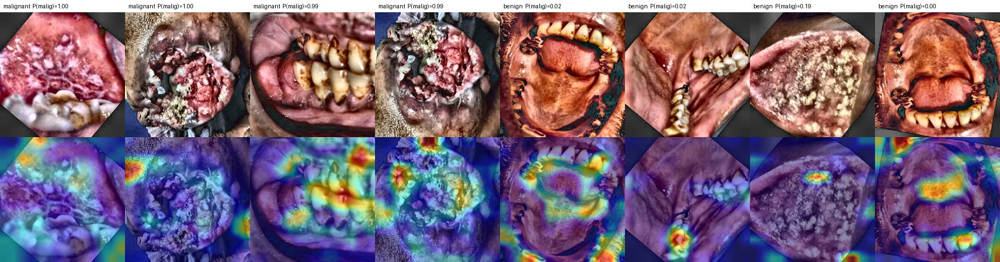
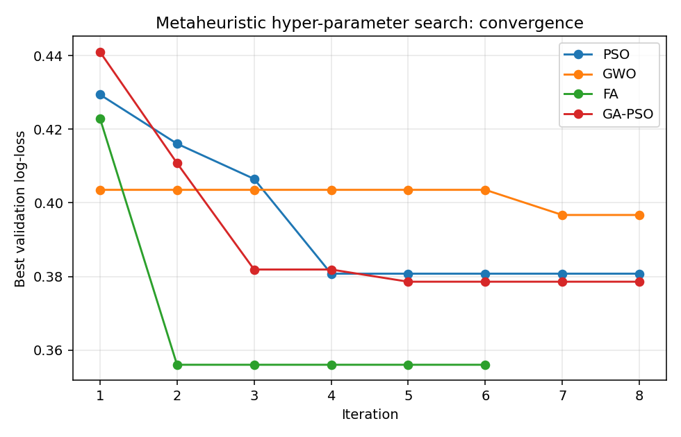

# Meta-X-DTL: Metaheuristic-Guided Explainable Transfer Learning for Oral Lesion Diagnosis

Meta-X-DTL classifies oral lesion photographs as **benign or malignant**. It combines **transfer learning (VGG16)**,
**metaheuristic optimisation** (PSO, Grey Wolf Optimizer, Firefly Algorithm, hybrid GA-PSO) and **Grad-CAM explainability**.
It ships with a Flask API and a web app that shows the prediction, a heatmap of *where* the model looked, and an optional
plain-language explanation from an LLM.

> Companion code for: **Metaheuristic-Driven Optimization Framework for Deep Learning: Enhancing Diagnostic Efficacy in
> Oral Pathological Classification**, *IEEE ICICI 2026*.



*Test images the model has never seen. Top: PSO-enhanced input. Bottom: Grad-CAM, where red marks the regions that drove the prediction.*

---

## Pipeline

```
Photos ─► 1. Leak-free split ─► 2. PSO image enhancement ─► 3. VGG16 features (ImageNet, frozen)
                                                                   │
                       4. Metaheuristic hyper-parameter search ◄───┘
                          PSO · GWO · Firefly · GA-PSO  (minimise validation loss)
                                       │
                       5. Classifier head ─► diagnosis + Grad-CAM heatmap ─► Flask API / web app
```

| Step | Script | What it does |
|---|---|---|
| 1 | [`01_prepare_data.py`](01_prepare_data.py) | Groups each photo with its augmented copies, then makes a **group-wise** 70/15/15 split |
| 2 | [`02_pso_enhancement.py`](02_pso_enhancement.py) | **PSO** tunes contrast, brightness and CLAHE to maximise an entropy × edge-strength objective |
| 3 | [`03_extract_features.py`](03_extract_features.py) | VGG16 transfer-learning features (+ flip augmentation, train split only) |
| 4 | [`04_metaheuristic_hpo.py`](04_metaheuristic_hpo.py) | **PSO, GWO, FA and GA-PSO** each tune the classifier (learning rate, dropout, units, L2) |
| 5 | [`05_classical_baseline.py`](05_classical_baseline.py) | Colour, GLCM and LBP features + **GA-PSO feature selection** + SVM |
| 6 | [`06_gradcam_report.py`](06_gradcam_report.py) | End-to-end test of the deployed model + Grad-CAM figure |
| 7 | [`07_finetune.py`](07_finetune.py) | Fine-tunes VGG16 block5 with augmentation |
| 8 | [`08_ablation.py`](08_ablation.py) | Backbone (VGG16 / ResNet50) × input (original / enhanced) × head, plus ensembles |

All four optimisers are implemented from scratch in [`src/metaheuristics.py`](src/metaheuristics.py), following their
original papers (Kennedy & Eberhart 1995; Mirjalili et al. 2014; Yang 2008; GA-PSO hybrid). They were checked on the
Sphere and Rastrigin benchmark functions.

## Leak-free evaluation (important)

The dataset has **2,165 images**, but many are rotated, zoomed, cropped or flipped **copies of the same photograph**, and
the copies can't be identified by filename. A random split puts copies of one photo in both training and test, and
accuracy becomes inflated.

[`01_prepare_data.py`](01_prepare_data.py) fixes this:
1. **Candidate look-alikes:** the 20 nearest neighbours of each image by CNN embedding (flip-averaged).
2. **Verification:** SIFT keypoints + RANSAC homography on the image and its mirror, or very high embedding similarity.
3. **Grouping:** connected components give **287 distinct photo groups** (282 of which contain augmented copies).
4. **Split by group:** train 1,655 · validation 297 · **test 213** images. No photo or copy of it crosses splits.

**How much this matters:** with the same SVM features, a random cross-validation reports **93%**, but the
leak-free test set gives **68%**.

## Results (held-out test set, 213 unseen images)

| Model | Accuracy | Balanced acc. | Sensitivity | Specificity | F1 | ROC-AUC |
|---|---|---|---|---|---|---|
| SVM + hand-crafted features (classical baseline) | 68.1% | 67.1% | – | – | 0.62 | 0.680 |
| VGG16, default head (no optimisation) | 71.4% | 70.8% | 66.7% | 75.0% | 0.67 | 0.792 |
| VGG16 + **PSO**-tuned head | 71.8% | 71.0% | 64.5% | 77.5% | 0.67 | 0.817 |
| VGG16 + **GWO**-tuned head | 71.8% | 70.8% | 62.4% | 79.2% | 0.66 | 0.819 |
| VGG16 + **GA-PSO**-tuned head | **75.1%** | **74.2%** | 66.7% | 81.7% | **0.70** | 0.825 |
| VGG16 + **Firefly**-tuned head *(selected on validation)* | 74.7% | 73.4% | 63.4% | **83.3%** | 0.69 | **0.833** |

**Findings**
- **Metaheuristic tuning helps:** every optimiser beats the default head on ROC-AUC (+0.025 to +0.041), and FA and GA-PSO
  add about 3–4 points of accuracy.
- **Firefly converged fastest** and reached the lowest validation loss. Note that it used 99 evaluations versus 72 for the others.
- **PSO enhancement helps VGG16** (validation log-loss 0.297 vs 0.370 on original photos) but **hurts ResNet50**: the
  preprocessing should be tuned per backbone.
- **Fine-tuning VGG16's block5** (73.7%) and an **ensemble of the four tuned heads** (74.7%) did not beat the single
  FA-tuned model, so the deployed model stays the frozen backbone with the FA-tuned head.



Every configuration, with validation and test metrics, is in [`results/ablation.csv`](results/ablation.csv). All
selections were made on the **validation** split only.

### Note on the paper's reported accuracy
The paper reports **90.38%** accuracy using a random, image-level split of this dataset. This repository re-evaluates the
method under a **stricter, group-wise protocol** where augmented copies of a photo never appear in both training and test,
which gives **74.7% accuracy / 0.83 ROC-AUC**. The difference comes from the evaluation protocol: near-duplicate images make
a random split much easier.

## Explainability (Grad-CAM)

[`src/gradcam.py`](src/gradcam.py) implements Grad-CAM (Selvaraju et al., 2017) on VGG16's `block5_conv3`: the
gradients of the predicted class are global-average-pooled into channel weights, and the weighted feature maps are
ReLU'd and upsampled. On many malignant cases the heatmap covers the lesion. In some images it also highlights
**teeth or image borders**, which shows the model partly relies on context. This is a known risk with small medical
datasets and a target for future work (lesion-focused cropping and segmentation masks).

## Web app

```bash
python server.py            # API on http://127.0.0.1:9001
```
Then open `index.html`, upload a photo and get the diagnosis, confidence and Grad-CAM heatmap.
For the optional plain-language explanation, copy `.env.example` to `.env` and put your key after `GEMINI_API_KEY=`.

| Endpoint | Description |
|---|---|
| `POST /diagnose` | image → diagnosis, confidence, Grad-CAM overlay (base64) |
| `POST /get_explanation` | diagnosis → patient-friendly explanation (Gemini) |
| `POST /explain_term` | medical term → one-line definition (Gemini) |

## Reproduce

```bash
git clone https://github.com/shubhreeka/Meta-X-DTL.git && cd Meta-X-DTL
python -m venv venv && venv\Scripts\activate        # macOS/Linux: source venv/bin/activate
pip install -r requirements.txt

# Point to the dataset folder that contains original_data/ and augmented_data/
set ORAL_DATA_ROOT=path\to\Oral Images Dataset       # macOS/Linux: export ORAL_DATA_ROOT=...

python 01_prepare_data.py
python 02_pso_enhancement.py
python 03_extract_features.py
python 04_metaheuristic_hpo.py      # ~45 min on CPU
python 05_classical_baseline.py
python 06_gradcam_report.py
python 08_ablation.py               # optional
```

The dataset and trained weights are not stored in this repository.

## Limitations & future work
- Small dataset: only **287 distinct photos**, so the test set has wide confidence intervals.
- No patient IDs: different photos of the same patient could still fall into different splits.
- Grad-CAM sometimes highlights teeth or borders. Next steps: lesion cropping, segmentation-guided training and external validation.
- **Research prototype, not a medical device.** Predictions must not be used for diagnosis.

## Author

**Shubhreeka Saxena**, B.Tech AI & ML, VIPS-TC (GGSIPU)
[LinkedIn](https://www.linkedin.com/in/shubhreeka-saxena/) · [GitHub](https://github.com/shubhreeka)
